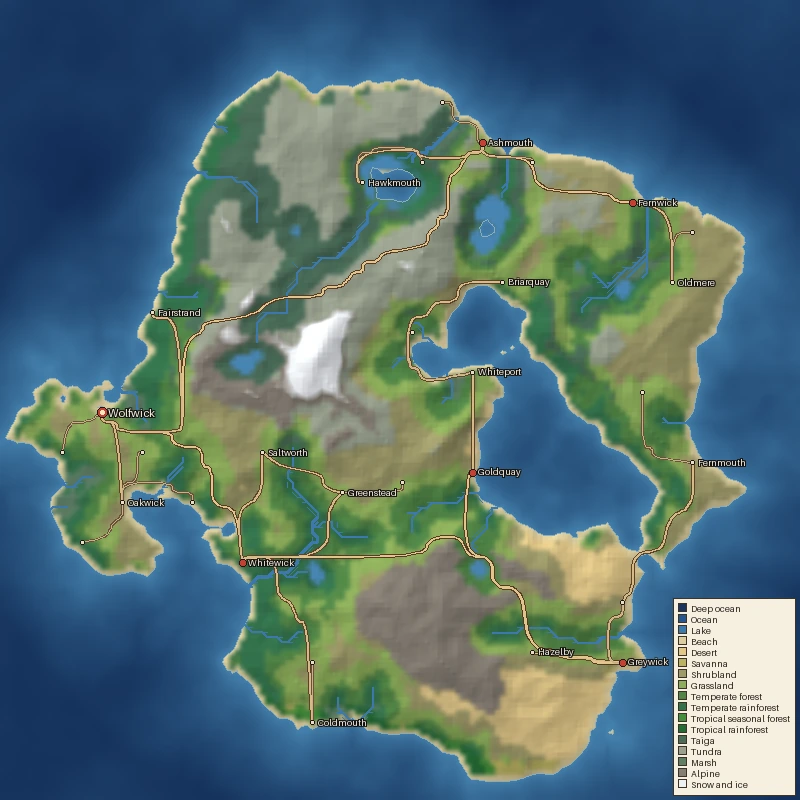
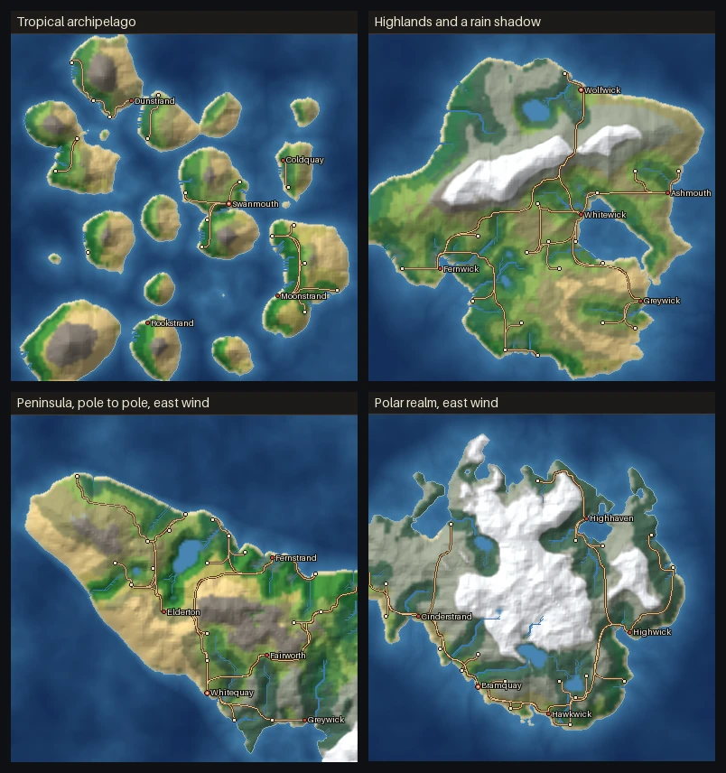
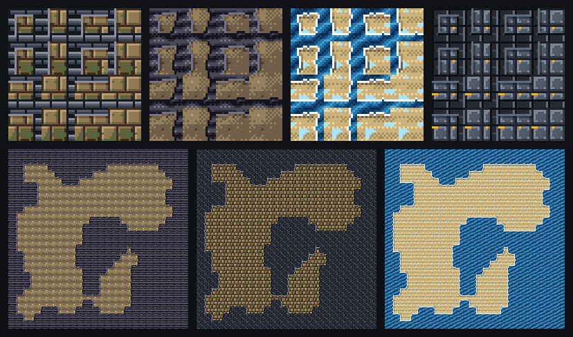
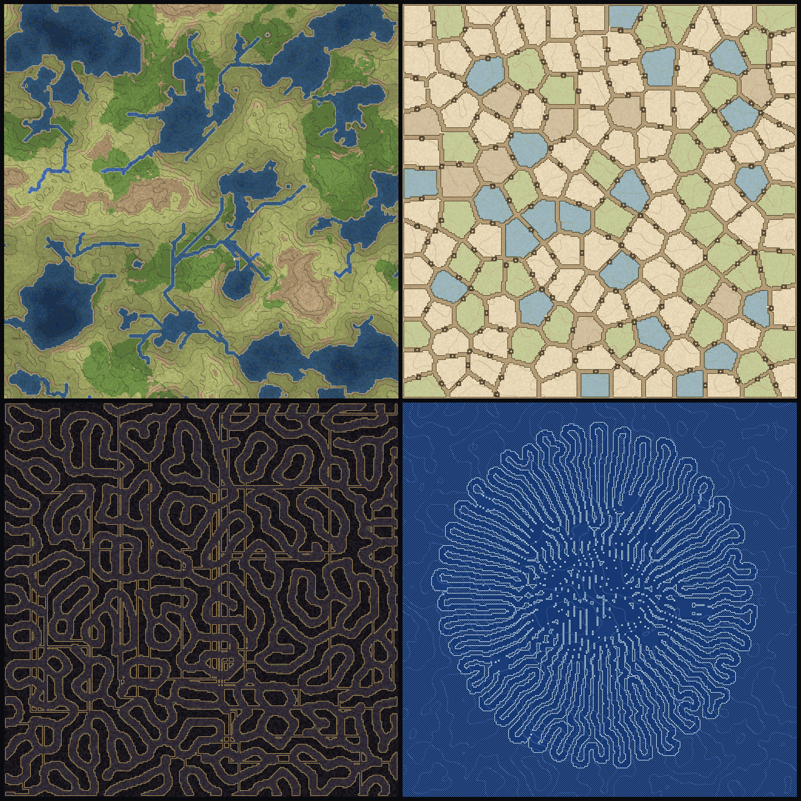
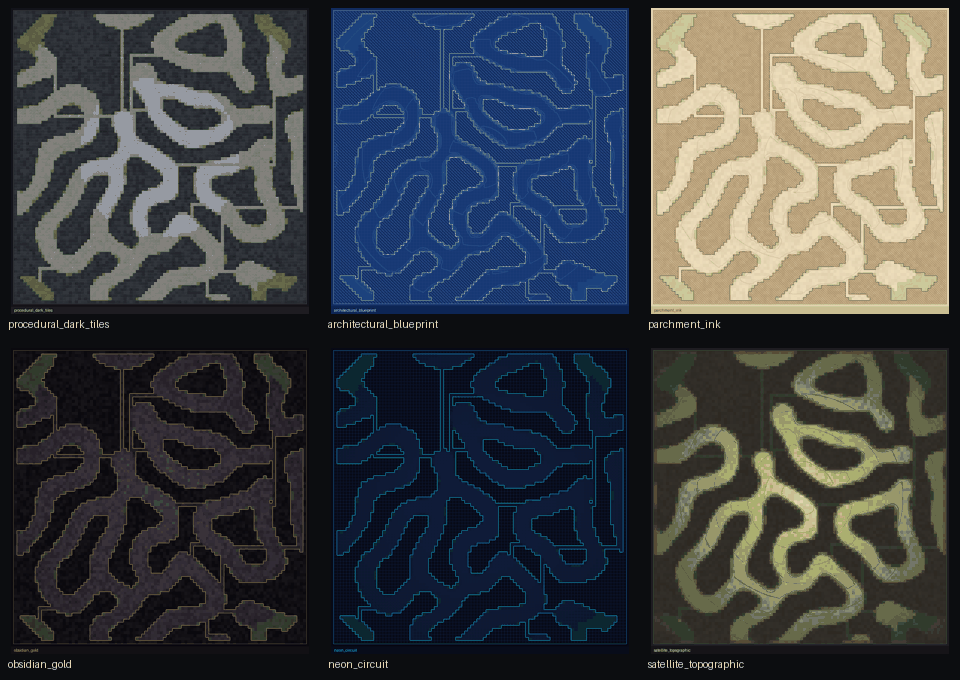

# Ultimate 2D Worldgen

**Procedural 2D worlds in Python: from mathematical map grammars to living
overworlds, with a constraint-solving toolkit, gameplay depth layers and tile
rendering in six styles.** Everything is seeded, deterministic, offline and
built on NumPy and Pillow alone.



*One seed, no hand-placed data: the landmass is eroded, the wind rains out on
the windward slopes, biomes follow temperature and moisture, rivers find the
sea, towns take the best sites and roads are surveyed between them.*

## Highlights

- **22 map families** — Voronoi kingdoms, reaction-diffusion labyrinths,
  differential growth, Truchet knots, space-filling curves, quasicrystals,
  watersheds, tectonic plates, cellular caves, climate overworlds and more,
  each a field-first grammar with a `(spec, rng) -> TileMap` contract.
- **Climate overworlds** — continents, archipelagos, highlands and peninsulas;
  latitude and lapse-rate temperature, orographic rain with real rain
  shadows, 14 land biomes (Whittaker bands with coast, marsh and mountain
  overrides), rain-fed rivers and lakes, central-place settlement siting and
  hiking-cost road networks that share trunks and bridge rivers.
- **Constraint and synthesis toolkit** — overlapping-model wave function
  collapse, socket WFC with D4 variants, count quotas and backtracking with
  banning on a shared bitmask CSP core, and ConvChain (Metropolis synthesis
  in the style of a sample).
- **Exact computational geometry** — Delaunay triangulation, clipped Voronoi
  cells, Lloyd relaxation, Gabriel / relative-neighbourhood / minimum spanning
  graphs, contour rings with nesting, RBF fields, variable-radius Poisson discs.
- **Level design passes** — dead-end retraction and loop insertion, corridor
  metrics, diagonal-kiss cleanup, inertia routing, lock-and-key gating with a
  solvability proof, a bot playtest with a fun score, and a JSON level
  blueprint export.
- **Roguelike Depth Layers** — 40 simulation features compile a map into
  places, factions, shops, guards, rumours, quests and events, ordered by a
  dependency graph and checked by design lint.
- **Rendering** — six style profiles over shared geometry, procedural
  Wang-16 and 47-blob autotiles in four skins, and a finished-map renderer for
  overworlds.
- **Proven compatibility** — the original 100-layout catalog is frozen and
  rebuilt byte-for-byte by the regression suite; every extension registers at
  import time.

## Quick start

Python 3.11 or newer with NumPy and Pillow ([`requirements.txt`](requirements.txt)).
No service, API key, network connection or external art is needed.

```sh
python -m pip install -r requirements.txt
python tilegen_full_stack_bundle/tilegen_atlas.py --size 96      # 66 maps x 6 styles + viewer
python tilegen_full_stack_bundle/tilegen_atlas.py --worlds-only  # compiled example worlds
python scripts/build_docs_images.py                              # the overworld and autotile pictures
```

Open `tilegen_full_stack_bundle/tilegen_atlas_output/viewer.html` in a browser
to flip every map through every style. If your platform uses `python3` or
`py -3`, substitute that for `python`.

## Make an overworld

Run from `tilegen_full_stack_bundle` so the modules import:

```python
import tilegen_overworld as ow

tm = ow.gen_overworld({'size': 128, 'seed': 5, 'shape': 'continent',
                       'climate': 'temperate', 'wind': 'west'}, None)
ow.render_overworld(tm).save('overworld.webp')
for s in tm.settlements[:3]:
    print(s['name'], s['kind'], s['setting'])     # e.g. Wolfwick city port
```

`shape` is `continent`, `archipelago`, `highlands` or `peninsula`; `climate`
is `temperate`, `tropical`, `polar` or `pole_to_pole`; `wind` comes from the
west, east, north or south. Other knobs: `land_ratio`, `erosion`, `aridity`,
`lake_ratio`, `river_ratio`, `mountain_ratio`, `settlements`, `loops`,
`exits`. The result is an ordinary `TileMap` (peaks are walls, roads are
platforms, river crossings are bridges) carrying `elevation`, `temperature`,
`moisture`, `biome` and `cover` fields plus `settlements` and `routes`
records, so the runtime, the world compiler and every style accept it.



## Compile a world

```python
from tilegen_compiler import WorldRecipe, compile_recipe, export_world

world = compile_recipe(WorldRecipe(
    name="The Obsidian Salt Keep",
    macro="voronoi_kingdoms", structure="reaction_diffusion",
    circulation="river_delta", ornament="truchet",
    symmetry=0.72, organicity=0.84, verticality=0.30,
    erosion=0.42, secret_density=0.15,
    style="obsidian_gold", seed=93741, size=128,
))
export_world(world, "out/salt-keep")
```

The compiler builds geometry, places and 40 simulation features in
dependency order, then runs design checks. Exports include JSON records,
NumPy field stacks, rendered maps and Markdown level specifications. Any map
family works as the `macro`, including `overworld` and `ca_caves`.

## Synthesis and level-design toolkit

Each module is opt-in: importing it changes no default output.

```python
import random
import numpy as np
import tilegen_grammars as tg, tilegen_grammars2
import tilegen_wfc as wfc, tilegen_convchain as cc, tilegen_keylock as kl
import tilegen_autotile as ta

ring = np.array([[0, 0, 0, 0], [0, 1, 1, 0], [0, 1, 1, 0], [0, 0, 0, 0]])
grid, stats = wfc.overlapping_wfc(ring, 32, 32, n=3, symmetry=8, seed=7)   # every 3x3 window seen in the exemplar

cave = tg.GRAMMARS['ca_caves']({'size': 48, 'seed': 3}, random.Random(3))
twin = cc.convchain_tilemap(cave, 64, 64, seed=1)                          # a new map in the cave's style

plan = kl.plan_on_mask(tg.passable_mask(twin), locks=2, seed=4)            # locks on chokepoints, keys before them
kl.apply_plan(twin, plan)

ta.render_autotile(twin, 'shore', scheme='blob').save('islands.png')       # procedural 47-blob autotiles
```

| Module | What it does |
|---|---|
| `tilegen_wfc.py` | Overlapping-model WFC: N×N patterns from an exemplar, symmetry, ground rule, quotas, restarts on named seed streams |
| `tilegen_socket_ext.py` | Socket WFC over map modules: D4 variants, domains, pins, weights, count quotas, `backtrack=` |
| `tilegen_csp.py` · `tilegen_backtrack.py` | Bitmask arc consistency, quotas and contradiction hooks; chronological backtracking with banning |
| `tilegen_convchain.py` | ConvChain: Metropolis sweeps over learned window weights |
| `tilegen_vector.py` | Exact Delaunay, clipped Voronoi, Lloyd, proximity graphs, contour rings, RBF fields |
| `tilegen_corridors.py` | Dead-end retraction, cycle rank, loop insertion, diagonal-kiss cleanup |
| `tilegen_routes.py` | Equal-cost routes that hold their heading |
| `tilegen_keylock.py` | Lock-and-key gating with an independent solvability check (`nar.gates`) |
| `tilegen_playtest.py` · `tilegen_blueprint.py` | Bot playtest and fun score; engine-neutral level blueprint JSON |
| `tilegen_autotile.py` | Wang-16 sheets and 47-blob tiles: dungeon, cave, shore and tech skins, four palettes each |



## Map families

| # | Family | Mathematics |
|---|---|---|
| 1 | Voronoi Kingdoms | Poisson-disc sites, Lloyd relaxation, region adjacency, gates on shared borders |
| 2 | Reaction-Diffusion | Gray–Scott, 9 presets (coral, fingerprint, mitosis, worms…) |
| 3 | Differential Growth | Rest-length springs + grid-accelerated repulsion; a loop that folds |
| 4 | Truchet Knots | Quarter-arc lattice, loop tracing, hill-climbed rotations |
| 5 | Space-Filling Curves | Hilbert, Moore, Peano, Gosper, Sierpiński |
| 6 | Quasicrystal Temples | N plane waves at π/N — rotational symmetry without period |
| 7 | Phyllotaxis Cities | Golden-angle districts |
| 8 | L-System Root Worlds | Branch depth encodes hierarchy: trunk→highway, twig→secret |
| 9 | DLA Crystal Caverns | Diffusion-limited aggregation dendrites |
| 10 | Watershed / River Delta | Priority-flood filling, D8 accumulation, traced channels |
| 11 | Tectonic Worlds | Plate motion vectors → convergent, divergent, transform boundaries; `plate_shape='frontier'` cuts jagged plates by a random-order flood fill |
| 12 | Flow-Field Maps | Curl-noise streamlines |
| 13 | Contour Architecture | Quantised elevation → terraces, retaining walls, stairs |
| 14 | Circuit Megacities | Manhattan traces, pads, chips, vias |
| 15 | Transit Networks | Graph first, then embedded and inflated into districts |
| 16 | Non-Euclidean Portals | A topology that exceeds its visible footprint |
| 17 | Fractal Archipelagos | Domain-warped coastlines, causeways |
| 18 | Generative Mandalas | Symmetry groups, star polygons, one deliberately broken wedge |
| 19 | Semantic Silhouettes | SDF shapes — serpent, crown, skull, sigil, machine, hand |
| 20 | Hybrid Morph | Any two pattern sources through a typed operator |
| 21 | Cellular Caves | Neighbour-count automaton, fill tuned to a target open ratio, Prim-ordered room joins |
| 22 | Climate Overworlds | Eroded landmass, lapse-rate temperature, orographic rain sweep, Whittaker biomes, rain-weighted rivers, central-place siting, Tobler-cost A* roads |

Every family is checked for a single walkable component, a usable open
ratio, determinism and seed sensitivity, at 64×64 and at 192×192. The hybrid
family can cross any two field sources; `ca_caves` and `overworld` are among
them.



## Roguelike Depth Layers

The world compiler turns any map into a gameplay snapshot: places and their
semantics (sound, light, privacy, memory), ecology and logistics, and these
town and adventure systems.

| # | Game system |
|---|---|
| 41 | Faction Territories |
| 42 | Faction Influence and Rivalries |
| 43 | Town Rules and Guard Responses |
| 44 | Shops, Trading, and Prices |
| 45 | NPC Work and Wages |
| 46 | Buildings, Ownership, and Succession |
| 47 | Smuggler NPCs and Hidden Shops |
| 48 | NPC Reputation and Disguises |
| 49 | NPC Alliances, Rivalries, and Cooperation |
| 50 | Fantasy Customs and Faction Traditions |
| 51 | Guard Vision and Stealth Detection |
| 52 | Faction Alliances and Negotiations |
| 53 | Combat Encounters and Alert Levels |
| 54 | Clues and Investigation Quest Hooks |
| 55 | Settlement Health and Environmental Hazards |
| 56 | Settlement Supplies and Resources |
| 57 | Building Durability and Damage |
| 58 | Quest Objectives and Dungeon Missions |
| 59 | World Event History |
| 60 | Encounter and Quest Director |

Movement, sound, alliances and rivalries use separate connection graphs.
Features declare what they consume and produce, so their order comes from a
dependency graph, and every feature degrades gracefully on maps without
water, lava or plazas. Six styles share the same geometry:
`procedural_dark_tiles`, `architectural_blueprint`, `parchment_ink`,
`obsidian_gold`, `neon_circuit` and `satellite_topographic`.



The runtime helpers provide scheduled pathfinding, viewport culling,
precomputed navigation, background chunk loading and resolution scaling; the
legacy runtime assembles 16×16 socket-WFC worlds and walks them with NPC,
turtle and drone agents. [See the demonstration](docs/DEMONSTRATION.md) for
routes, assembled dungeons, compiled worlds and every catalog.

## Repository layout

| Path | Purpose |
|---|---|
| `tilegen_full_stack_bundle/` | Engine, families, toolkits, compiler, atlas, tests |
| `tilegen_full_stack_bundle/tilegen_system.py` | The original 35 templates and 100 layouts, byte-frozen |
| `tilegen_full_stack_bundle/tilegen_fields.py` | NumPy field engine: noise, distance fields, hydrology, erosion, Poisson discs |
| `tilegen_full_stack_bundle/tilegen_grammars.py` · `tilegen_grammars2.py` | Map families 1–21 |
| `tilegen_full_stack_bundle/tilegen_overworld.py` | Map family 22, climate overworlds, and the overworld renderer |
| `tilegen_full_stack_bundle/tilegen_world.py` · `tilegen_layers.py` · `tilegen_society.py` · `tilegen_compiler.py` | Places, topologies, the 40 features, recipes and design lint |
| `tilegen_full_stack_bundle/tilegen_style.py` | Style profiles and the neighbourhood renderer |
| `tilegen_full_stack_bundle/tilegen_*output/` | Generated catalogs, renders, viewers and compiled worlds |
| `tilegen_project_bundle/` | The original standalone 100-layout bundle |
| `infernal_data_first.py` | A separate standard-library world simulation with an optional Tk viewer |
| `scripts/` | Public-file check, portable runtime export, docs pictures |
| `docs/` | Illustrations and the picture tour |

## Generated files

Map textures, symbols and simulation visuals are drawn procedurally; labels
use Pillow's bundled font. The `tilegen_output`, `tilegen_runtime_output` and
`tilegen_atlas_output` directories hold generated artifacts: change generator
code or specs and rebuild rather than editing them. To refresh compiled JSON
and Markdown while keeping images and field arrays, use
`python tilegen_full_stack_bundle/tilegen_atlas.py --worlds-only --text-only`.
`python scripts/build_runtime.py` rebuilds the runtime outputs with portable
source paths, and `python scripts/build_docs_images.py` rebuilds
`docs/overworld.webp`, `docs/overworlds.webp` and `docs/autotiles.webp`.

## Verify offline

From the repository root:

```sh
python scripts/check_public.py
python tilegen_full_stack_bundle/test_goals.py --full    # 22 families, 40 features, every toolkit
python tilegen_full_stack_bundle/test_atlas.py --full    # regression, including the golden 100-layout rebuild
python infernal_data_first.py --self-test
python infernal_data_first.py --headless --width 24 --height 24 --steps 2
```

The suites put scratch outputs under `.local/` and remove them afterwards.
No hosted workflow is required.

## Scope and limits

These are generators and gameplay snapshots, not a running game: the depth
features produce data a game would consume and advance, and gameplay balance
has not been evaluated in one. Named seed streams make builds reproducible
within one software environment; exact PNG bytes and floating-point results
can differ across NumPy, Pillow or platform versions, so compare golden
outputs in the same environment. Large worlds can be slow where per-place
rumour propagation and particle-based families dominate. Tk is optional; the
headless tools need only Python, NumPy and Pillow. See
[HANDOFF.md](HANDOFF.md) for known limitations and [CHANGELOG.md](CHANGELOG.md)
for what changed.

Licensed under the [MIT License](LICENSE).
